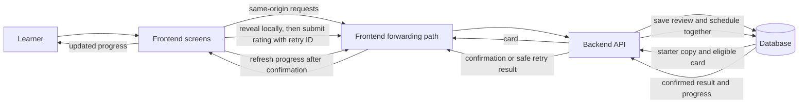

# Frontend V1: dependency-linked ticket drafts

Status: working roadmap and ticket drafts. The sequence and technology choices can change as the spec is refined in later grill sessions. No issues, infrastructure, or application code are created by this document.

Parent specification: [Top Vino frontend V1](./frontend-v1-spec.md). Story numbers below refer to its User Stories.

## How to use this plan

- Each `V1-NN` is a narrow, end-to-end slice, not a request to build an entire horizontal layer.
- `AFK` means bounded implementation/test work that an implementer can execute without a new product decision. `HITL` requires operator access, live evidence, or human design/acceptance review.
- A slice is complete only when all involved repositories integrate and its acceptance criteria pass. A backend PR alone does not complete a user-facing slice.
- Future frontend issues belong to the separate frontend tracker. Backend-only operational prerequisites belong to `Pilks-pixel/top_vino_backend`.
- When publishing a cross-repository slice, create a frontend coordinating issue and a backend implementation issue from that slice's explicit backend-work section. Make the backend issue a blocker of frontend completion, and copy the slice's external blockers to the appropriate issue(s). Keep the end-to-end acceptance criteria on the coordinator.
- This graph expresses complete-slice dependencies. Repository-specific issue numbers and native blocking links are intentionally not invented before publication.
- Blocked work must not be treated as ready because a similarly named schema field exists.
- Independent graph nodes are not automatically safe for concurrent edits to the same files. Coordinate overlapping backend work.
- Use synthetic data for development and proofs. No real-user launch until V1-14.

## Roadmap

This is a guide, not a fixed delivery contract. Review the next slice before building it; use later grill sessions and what we learn from implementation to revisit scope, dependencies, and stack choices. Update the spec, these drafts, and any published issues together when a decision changes. Keep the launch gates below visible even if the order changes.

The first integrated milestone uses synthetic data: **copy a starter deck → reveal and rate a card → retry a lost response safely → see updated progress**. It needs a signed-in test account, but does not wait for Topics, cloze authoring, full dashboards, or real-user onboarding.

The forwarding path and named technologies reflect the current spec, and are open to review. The backend remains responsible for access, study rules, saving, retry safety, and progress calculations.

### Live beta launch gates

Real learners enter only at **V1-14**, after these are proven on the actual candidate setup:

- **Isolation and $0:** retained beta data is separate from the disposable sandbox; provider eligibility, quotas, and billing controls are verified (V1-01, V1-14).
- **Browser and release safety:** final origins, sessions, proxy security, compatible independent releases, and rollback work (V1-02, V1-13, V1-14).
- **Invitations and email:** private onboarding and recovery work, including delivery to two providers and sender-token operation after more than seven days (V1-03, V1-14).
- **Recovery:** encrypted independent backup and a successful restore of the full release schema, with realistic recovery targets and an operator response (V1-04, V1-14).
- **Learner experience:** original starter content, real-phone and accessibility review, clear beta limitations, and a support/removal contact are accepted (V1-13, V1-14).

### Slices

| ID | Slice | Type | Blocked by | Coordinating tracker | Stories |
| --- | --- | --- | --- | --- | --- |
| V1-01 | Establish an isolated, zero-cost beta candidate | HITL | None | Backend | 29, 32, 33 |
| V1-02 | Sign in through the independently deployed Next.js frontend | HITL | V1-01 | Frontend + backend work | 2, 25, 26, 27, 33, 34 |
| V1-03 | Invite a learner and recover their password by email | HITL | V1-02 | Frontend + backend work | 1, 3, 4, 30, 35 |
| V1-04 | Restore an encrypted backup from independent storage | HITL | V1-01 | Backend | 29, 31, 32, 35 |
| V1-05A | First integrated starter study journey | AFK | V1-02 | Frontend + backend work | 4, 10, 14, 15, 16, 17, 18, 21, 27, 28 |
| V1-05 | Create and edit a personal deck with basic cards | AFK | V1-05A | Frontend + backend work | 7, 8, 11, 25, 26, 27 |
| V1-06 | Organize decks into flat Topics safely | AFK | V1-05 | Frontend + backend work | 5, 6, 27 |
| V1-07 | Author and preview valid cloze cards | AFK | V1-05 | Frontend + backend work | 9, 11, 25, 26 |
| V1-08 | Complete basic-card study and daily allowance | AFK | V1-05A | Frontend + backend work | 4, 14, 15, 16, 17, 18, 27 |
| V1-09 | Study every scope and practise forgotten cards | AFK | V1-06, V1-07, V1-08 | Frontend + backend work | 13, 14, 16, 17, 18, 19 |
| V1-10 | Expand starter copies to Topics and cloze cards | AFK | V1-05A, V1-06, V1-07 | Frontend + backend work | 10, 27, 28 |
| V1-11 | Archive and restore material without losing history | AFK | V1-06, V1-08 | Frontend + backend work | 6, 12, 14, 27 |
| V1-12 | Expand progress and upcoming workload | AFK | V1-05A, V1-06, V1-08, V1-11 | Frontend + backend work | 20, 21, 22, 23, 24 |
| V1-13 | Validate the complete mobile and accessible experience | HITL | V1-03, V1-09, V1-10, V1-11, V1-12 | Frontend + backend fixes as needed | 18, 25, 26, 34, 35 |
| V1-14 | Admit the first learners through a gated beta release | HITL | V1-04, V1-13 | Frontend + backend operations | 1, 28, 29, 30, 31, 32, 33, 35 |

### Suggested order

1. Establish the candidate and sign in with a synthetic account (V1-01, V1-02).
2. Deliver and demonstrate the first integrated journey (V1-05A). Start the independent backup and email proofs as capacity allows; the seven-day email check needs lead time.
3. Build personal authoring, Topics, cloze, and the complete study rules (V1-05–V1-09), following the blockers above. Extend starter copies, archive, and progress (V1-10–V1-12).
4. Check the full experience and all live gates before inviting anyone (V1-13, V1-14). Independent slices can move earlier when their stated dependencies are met.

## V1-01 - Establish an isolated, zero-cost beta candidate

**Type:** HITL  
**Blocked by:** None  
**Stories:** 29, 32, 33  
**Tracker:** Backend

### What to build

Prove that an isolated API/database candidate can support retained beta data without changing the disposable sandbox or enabling paid usage. Keep the existing backend identity and architecture. This is a runnable environment/policy slice, not an invitation to admit learners.

### Backend work

Separate deployment purpose from production hardening: sandbox and beta need explicit, fail-closed policies. Inventory the intended API/database resources, free quotas, rollback path, and release identity. Preserve sandbox auth restrictions, synthetic-data tooling protections, and its existing $0 rules.

### Acceptance criteria

- [ ] A synthetic record survives an ordinary candidate-service restart/redeploy; this is explicitly not treated as a backup/restore proof.
- [ ] Sandbox reset/provisioning operations cannot target retained beta data accidentally.
- [ ] Existing sandbox security/documentation tests still pass under its original configuration.
- [ ] Candidate health/readiness, schema compatibility, release identity, and rollback procedure are demonstrated.
- [ ] Actual accounts/plans, shared quotas, payment settings, and pause-on-exhaustion behavior are documented without credentials.
- [ ] No paid fallback, owner-level runtime database credential, or unapproved account/resource is introduced.
- [ ] Any $0 or isolation contradiction blocks this slice and reopens the plan.

## V1-02 - Sign in through the independently deployed Next.js frontend

**Type:** HITL  
**Blocked by:** V1-01  
**Stories:** 2, 25, 26, 27, 33, 34  
**Tracker:** Frontend coordinator; backend companion required

### What to build

A thin Next.js/TypeScript app that can sign in with an isolated synthetic account through its own origin, display a protected empty-library screen, survive reload, and sign out. Introduce TanStack Query, Tailwind theme tokens, and only the shadcn/ui controls required for this journey.

### Backend work

Establish the canonical auth/frontend origin and validate cookies, forwarding, trusted origins, CSRF/Fetch Metadata, proxy identity, and rate limiting for the actual independent-host topology. Do not reuse a single-hop assumption untested.

### Learner-facing acceptance check

- [ ] I can sign in, return after a reload, and sign out on my phone or desktop.

### Acceptance criteria

- [ ] Vercel Hobby eligibility is confirmed for personal V1; no commercial-use or paid-overage assumption.
- [ ] API and frontend can deploy separately; the browser uses one narrow same-origin forwarding path.
- [ ] Sign-in, reload/session restoration, protected navigation, and sign-out work on phone and desktop.
- [ ] No auth tokens or backend/mail/database secrets are exposed through frontend storage or bundles.
- [ ] User-specific cache/state is cleared on logout/account changes; shared caches cannot serve authenticated responses.
- [ ] Untrusted origins, forged forwarding headers, unauthorized access, and unintended upstream paths fail safely.
- [ ] Deep-link reload, expired sessions, cold-start delays, and transport errors have honest UI states.
- [ ] A minimal supported frontend test harness and the first browser smoke check are runnable.

## V1-03 - Invite a learner and recover their password by email

**Type:** HITL  
**Blocked by:** V1-02  
**Stories:** 1, 3, 4, 30, 35  
**Tracker:** Frontend coordinator; backend companion required

### What to build

Operator-controlled real-user onboarding, password establishment, self-service recovery, password change, and a minimal account/support screen. Keep public registration and social login out of V1.

### Backend work

Use supported Better Auth mechanisms for operator-authorized accounts and expiring single-use recovery flows. Add a dedicated Gmail HTTPS sender with least-privilege authorization and safe failure reporting. Synthetic-only provisioning must not be relaxed or repurposed unchanged.

### Learner-facing acceptance check

- [ ] I can accept my invitation, set my own password, and recover access if I forget it.

### Acceptance criteria

- [ ] An invited person establishes their own password; no shared/operator-known password is emailed.
- [ ] Uninvited users cannot create accounts through alternate/auth-advertised endpoints.
- [ ] Reset requests do not disclose account existence; invalid, expired, reused, and foreign-origin reset links fail safely.
- [ ] Reset and password change have a tested session-revocation policy; no abandoned/old access is resurrected.
- [ ] Sender OAuth eligibility and publishing configuration are legitimate; only the operator authorizes the sender.
- [ ] Real reset mail reaches at least two target inbox providers; test refresh-token operation after more than seven days.
- [ ] Revoked sender access, delivery failure, and exhausted quotas produce actionable operator visibility without logging tokens or message bodies.
- [ ] Billing controls and current Gmail API policy are checked. Failure of the $0 delivery proof blocks real-user onboarding.
- [ ] The account screen explains beta limitations and provides an operator contact for account/data removal.

## V1-04 - Restore an encrypted backup from independent storage

**Type:** HITL  
**Blocked by:** V1-01  
**Stories:** 29, 31, 32, 35  
**Tracker:** Backend

### What to build

Demonstrate the complete recovery loop: consistent synthetic database export, encryption, private independent upload, operator download/decryption, restore into an isolated compatible database, and verification through the application.

### Backend/operations work

Evaluate independently scheduled GitHub Actions and private Google Drive using authorized operator OAuth and app-scoped file access. The job holds an encryption public key; the operator separately controls the private recovery key. Keep upload and mail credentials/privileges distinct.

### Acceptance criteria

- [ ] Explain backups in plain language using the specification's backup section; Drive is not the live application database.
- [ ] Only ciphertext is uploaded. No plaintext dumps, credentials, or recovery keys enter Git, artifacts, logs, or mail.
- [ ] Verify actual storage capacity, API billing rules, Actions quota/billing controls, and legitimate access to the private destination.
- [ ] Test missing credentials, revoked access, full storage, partial upload, failed encryption, and skipped/delayed schedules.
- [ ] Validate or revise the proposed six-hour attempts, 12-hour freshness alert/check, and seven-day retention against measured capacity and operator availability.
- [ ] Never remove the last known-good backup because a newer run failed.
- [ ] Restore every data type present in the candidate schema consistently; verify integrity and behavior, not only that a file downloaded. Repeat with Topics and archive state in the expanded V1-14 schema.
- [ ] Revoke restored sessions/outstanding invitation/reset credentials; document schema/application version and key recovery.
- [ ] Rehearse the <=24-hour data-loss / <=48-hour restoration targets and report observed limitations honestly. Best-effort cron is not a guaranteed SLA.
- [ ] Define backup expiry/account-removal handling. Unmet cost/recovery requirements block beta launch.

## V1-05A - First integrated starter study journey

**Type:** AFK  
**Blocked by:** V1-02  
**Stories:** 4, 10, 14–18, 21, 27, 28  
**Tracker:** Frontend coordinator; backend companion required

### What to build

With a synthetic signed-in learner and a small operator-reviewed original starter deck of basic cards, confirm a suggested timezone, copy the deck into Ungrouped, open it, reveal an answer, rate it, and see the saved review reflected in today's progress. Keep the current card and rating visible until the save is confirmed. Show clear loading, saving, retry, and error states.

### Backend work

Provide an operator-controlled starter listing and atomic, authorized, idempotent copy with new owned identities and no copied history. Provide a bounded, stable Deck queue with due cards before new cards, a confirmed learner timezone, and server-enforced default allowance of 10 new cards per local day. Map Forgot/Hard/Good/Easy to 0/3/4/5 and save history, SM-2 schedule, and allowance atomically; give each logical review a stable retry identity and reject stale conflicting attempts explicitly. Return an authorized count of saved Reviews today from history. Preserve access checks and the pinned frontend/API contract.

### Learner-facing acceptance check

- [ ] I can copy the starter deck, open a card, reveal its answer, choose a rating, and see my Reviews today increase once after the save is confirmed, including after a reload.
- [ ] If the response is lost, I can retry the same submission without losing my place or creating a second review; a conflicting attempt explains what to do next.

### Acceptance criteria

- [ ] Copy retries do not create duplicate or partial decks; the copy is private and independent of the original. Only approved original material is offered.
- [ ] The queue includes eligible new and due cards in the specified order; opening or revealing a card consumes no allowance. A first saved Forgot review does.
- [ ] Concurrent submissions cannot bypass the learner-wide daily allowance or create partial history/schedule updates. Backend tests cover the 10th and 11th new card and local-day boundaries.
- [ ] Ratings appear only after reveal; a pending or failed save is never shown as successful. Lost acknowledgements reconcile using the same identity, including after interruption; stale conflicts are recoverable.
- [ ] Today's count uses saved Review history and the learner's confirmed timezone, counts Forgot, and excludes retry duplicates. Another learner cannot access the copy or progress.
- [ ] A focused end-to-end test exercises the complete journey, including a lost acknowledgement and reload. Later slices extend this baseline rather than rebuilding it.

## V1-05 - Create and edit a personal deck with basic cards

**Type:** AFK  
**Blocked by:** V1-05A  
**Stories:** 7, 8, 11, 25, 26, 27  
**Tracker:** Frontend coordinator; backend companion required

### What to build

From an empty Library, create a deck, add a text prompt/answer card, open it again, and edit it. Use full-page phone editing, ordinary user-facing validation, and safe save/error behavior.

### Backend work

Verify and tighten the actual basic-card/deck contracts needed by this flow: nonempty required content, owned access, consistent error shapes, bounded payloads, and no silent truncation. Preserve compatibility intentionally rather than assuming current generic card storage guarantees a usable Basic Card.

### Learner-facing acceptance check

- [ ] I can create a deck, add a basic card, and find my changes after returning.

### Acceptance criteria

- [ ] Create/read/edit works end-to-end and persists across reload.
- [ ] Empty required text and oversized content are rejected with useful field/request errors.
- [ ] Another learner cannot read/edit private content by changing IDs.
- [ ] Unsaved changes are protected against accidental navigation; failed saves retain editor input.
- [ ] There is no unimplemented permanent-delete button, rich text, upload control, or card-type conversion.
- [ ] Editing a previously reviewed card preserves its scheduling/history.
- [ ] Tests use existing backend factories/contracts and focused frontend interactions.

## V1-06 - Organize decks into flat Topics safely

**Type:** AFK  
**Blocked by:** V1-05  
**Stories:** 5, 6, 27  
**Tracker:** Frontend coordinator; backend companion required

### What to build

Create/rename a Topic, assign or move an owned deck, return it to Ungrouped, and remove the Topic without losing decks or cards.

### Backend work

Add an owned Topic relationship, not merely a new free-text topic label. Enforce at most one Topic per deck, same-owner membership, and transactional ungrouping on Topic removal.

### Learner-facing acceptance check

- [ ] I can organize a deck in a Topic and remove that Topic without losing the deck.

### Acceptance criteria

- [ ] Existing decks migrate safely to Ungrouped without content or progress loss.
- [ ] Topic/deck views and direct URLs agree after create, move, rename, and removal.
- [ ] Cross-user Topic assignment/access is rejected.
- [ ] Removing a Topic preserves its decks, cards, and reviews. V1-11 adds the archived-content cases when that state exists.
- [ ] Empty Topics and Ungrouped have clear empty states.
- [ ] No nesting, multi-membership, or new access grants are introduced.

## V1-07 - Author and preview valid cloze cards

**Type:** AFK  
**Blocked by:** V1-05  
**Stories:** 9, 11, 25, 26  
**Tracker:** Frontend coordinator; backend companion required

### What to build

Write plain text, select one or more blanks, preview hidden/revealed text, save a Cloze Card, and reopen/edit it accurately. Authoring/preview is independently demoable before review integration in V1-09.

### Backend work

Define one canonical validated text/blanks representation. Current `type: cloze` storage is insufficient. Preserve safe text rendering and define treatment of any existing incomplete cloze records without inventing answers.

### Learner-facing acceptance check

- [ ] I can select words to hide, preview the card, and reopen it with the same blanks.

### Acceptance criteria

- [ ] All selected blanks hide/reveal together and persist as one card identity/schedule.
- [ ] Invalid, empty, overlapping, and out-of-range blanks cannot be saved; Unicode text round-trips correctly.
- [ ] Learners are not required to enter internal markup.
- [ ] Preview and later reviewer rendering use the same interpretation.
- [ ] No arbitrary HTML/script execution, rich text, or separately scheduled blanks.
- [ ] Ordinary edits retain existing progress; unsupported card-type conversion is not exposed.

## V1-08 - Complete basic-card study and daily allowance

**Type:** AFK  
**Blocked by:** V1-05A  
**Stories:** 4, 14, 15, 16, 17, 18, 27  
**Tracker:** Frontend coordinator; backend companion required

### What to build

Extend the V1-05A reviewer for everyday deck study, including a learner setting to increase or decrease the default daily new-card allowance. Preserve the integrated retry and progress behavior.

### Backend work

Provide bounded, deterministically ordered eligible work; saved learner timezone; atomic history/progress updates; logical submission idempotency; stale/concurrent attempt handling; and the configurable learner-global daily allowance (default 10). Keep SM-2 and map ratings to 0/3/4/5.

### Learner-facing acceptance check

- [ ] I can set my daily new-card allowance and study a deck without a retry counting twice.

### Acceptance criteria

- [ ] Due cards precede new cards; missing progress is handled as new, not a fatal 404.
- [ ] Grade controls appear only after reveal; the UI advances only after confirmed persistence.
- [ ] First saved reviews of 10 distinct new cards are accepted in one local day; an 11th is rejected safely.
- [ ] The learner can increase or decrease the allowance; the saved setting is enforced across Decks and tabs, and a first Forgot rating consumes one.
- [ ] Opening/revealing/abandoning a card consumes no allowance.
- [ ] Double clicks, lost acknowledgement, retries, and concurrent tabs cannot duplicate a logical review or produce partial history/progress.
- [ ] A stale conflicting attempt is explicit and recoverable rather than silently advancing a schedule twice.
- [ ] Saved progress survives reload; permission and eligibility checks occur at submission. V1-11 adds archive exclusion at the same seam.
- [ ] Timezone validation, day rollover, and daylight-saving boundaries have focused tests.

## V1-09 - Study every scope and practise forgotten cards

**Type:** AFK  
**Blocked by:** V1-06, V1-07, V1-08  
**Stories:** 13, 14, 16, 17, 18, 19  
**Tracker:** Frontend coordinator; backend companion required

### What to build

Use one focused reviewer for whole-library, Topic, and Deck study, supporting basic and cloze cards. On completion, offer optional ungraded Practice Repeats of forgotten cards.

### Backend work

Extend eligible-work selection to the authorized scopes with bounded pagination, stable ordering, and consistent global allowance. Do not create another scheduler or persist Practice Repeats as Reviews.

### Learner-facing acceptance check

- [ ] I can study my library, a Topic, or a deck and practise forgotten cards without changing my saved results.

### Acceptance criteria

- [ ] The same card has one learner schedule regardless of the entry scope.
- [ ] Scope selection cannot expose another learner's content or multiply daily allowance.
- [ ] Cloze reveals all blanks and saves one rating per card.
- [ ] Forgot retains next-day scheduling; Practice Repeats never change history, allowance, progress, or streaks.
- [ ] No-due, new-allowance-exhausted, empty-scope, stopped, and completed states are understandable.
- [ ] Saved work survives leaving/reloading; transient practice need not.
- [ ] Deterministic interaction tests cover prompt/reveal/save/retry/complete/practice.

## V1-10 - Expand starter copies to Topics and cloze cards

**Type:** AFK  
**Blocked by:** V1-05A, V1-06, V1-07  
**Stories:** 10, 27, 28  
**Tracker:** Frontend coordinator; backend companion required

### What to build

Extend the V1-05A starter catalog so a learner can copy supported basic and cloze material into Ungrouped or one owned Topic.

### Backend work

Define operator-controlled starter publication and an atomic, authorized copy operation. Copy supported content with new identities, not ownership, collaborators, progress, reviews, or other learner data.

### Learner-facing acceptance check

- [ ] I can copy a starter deck into my chosen location and edit my copy without changing the original.

### Acceptance criteria

- [ ] Only approved original starter material is listed; ordinary learners cannot self-publish catalog entries.
- [ ] Basic and valid cloze content round-trip into an owned copy.
- [ ] Retrying one copy action does not leave duplicate/partial copies.
- [ ] Editing the copy cannot change the original or anyone else's material.
- [ ] Updating the original does not silently update existing copies; the UI explains this.
- [ ] Empty/error/loading catalog states work; no public discovery or collaboration feature is introduced.

## V1-11 - Archive and restore material without losing history

**Type:** AFK  
**Blocked by:** V1-06, V1-08  
**Stories:** 6, 12, 14, 27  
**Tracker:** Frontend coordinator; backend companion required

### What to build

Archive a studied card or deck, find it in Archive, and restore it with its history intact.

### Backend work

Add consistent archive filtering/restoration across library, scoped study, submission checks, and future-work reads. Preserve historical Reviews and independent parent/child archive states.

### Learner-facing acceptance check

- [ ] I can archive and restore a card or deck and keep my study history.

### Acceptance criteria

- [ ] Archived content disappears from new study queues and current/future workload.
- [ ] A card archived after being displayed cannot accept an unnoticed stale submission.
- [ ] Restoring a deck does not restore cards independently archived earlier.
- [ ] Review history and scheduling state survive; restored overdue material becomes eligible according to its retained schedule.
- [ ] Topic removal still preserves archived decks.
- [ ] No foreign-owned archive/restore or ordinary permanent-delete action is possible.

## V1-12 - Expand progress and upcoming workload

**Type:** AFK  
**Blocked by:** V1-05A, V1-06, V1-08, V1-11  
**Stories:** 20, 21, 22, 23, 24  
**Tracker:** Frontend coordinator; backend companion required

### What to build

Extend the V1-05A Reviews-today count with due-now counts, 14-day activity, seven-day currently scheduled workload, and learner-wide Study Streak. Support meaningful library/Topic/deck views without fetching an entire review history into the browser.

### Backend work

Add bounded authorized aggregates over persisted history and current active schedules. Do not treat SM-2 review-success counters as lifetime Reviews or study days.

### Learner-facing acceptance check

- [ ] I can see what is due, what I studied, my streak, and the work currently scheduled ahead.

### Acceptance criteria

- [ ] Definitions match the specification, including local dates, zero-activity days, overdue separation, and no speculative future rating outcomes.
- [ ] Forgot counts as a Review; Practice Repeats and duplicate submission retries do not.
- [ ] Archived material contributes to actual past activity but not active due/future-work counts.
- [ ] Headline streak remains current when the most recent study date was yesterday and today is not over.
- [ ] Scope totals cannot expose another learner's data; Topic history follows current membership.
- [ ] Charts have accessible text/table equivalents and clear empty/error states.
- [ ] No mastery/exam-readiness score or unrequested new-card dashboard is added.

## V1-13 - Validate the complete mobile and accessible experience

**Type:** HITL  
**Blocked by:** V1-03, V1-09, V1-10, V1-11, V1-12  
**Stories:** 18, 25, 26, 34, 35  
**Tracker:** Frontend coordinator; backend corrections where failures require them

### What to build

Integrate and demonstrate the complete agreed journey in the light/pastel, restrained editorial visual system. Correct issues found in real browser/device use without expanding product scope.

### Backend work

Resolve contract/error/authorization defects exposed by integration. Preserve sandbox and existing security behavior; do not paper over failures with frontend-only guards.

### Learner-facing acceptance check

- [ ] I can complete the main journeys on my phone or desktop, including with a keyboard and assistive technology.

### Acceptance criteria

- [ ] Study / Library / Progress work with phone bottom navigation and desktop sidebar; review is focused and editing is usable on a phone.
- [ ] Human review covers typography, spacing, contrast, obvious actions, touch targets, and cloze selection on a real phone.
- [ ] Keyboard/focus/screen-reader names and chart alternatives are checked, alongside automated browser tests.
- [ ] Slow/cold API, expired sessions, offline interruptions, rejected saves, and lost acknowledgements never produce false success or duplicate progress.
- [ ] Unsaved edits are protected; loading/empty/error states do not strand the learner.
- [ ] Supported browsers and measured limitations are recorded.
- [ ] The owner approves the integrated UI and beta limitation/privacy/support wording.

## V1-14 - Admit the first learners through a gated beta release

**Type:** HITL  
**Blocked by:** V1-04, V1-13  
**Stories:** 1, 28, 29, 30, 31, 32, 33, 35  
**Tracker:** Frontend coordinator with backend operations

### What to build

Release the approved personal beta to 5-10 individually invited learners only after all technical and operational proofs are accepted.

### Backend/operations work

Recheck the actual retained-data environment, signing/sender/backup credentials, deployment compatibility, rollback, cost controls, and isolation from sandbox tooling. The operator supplies the reviewed starter set and handles invitations.

### Learner-facing acceptance check

- [ ] As an invited learner, I can start studying and understand the beta’s limitations and how to ask for help or data removal.

### Acceptance criteria

- [ ] Email delivery and more-than-seven-day sender-token evidence are accepted; expired/revoked credentials have an operational response.
- [ ] A usable encrypted backup and successful isolated restore exist for the complete release schema, including Topics and archive state, with key ownership, freshness checks, and realistic recovery targets.
- [ ] $0 controls, actual capacity, provider eligibility, and no-billing assumptions are current, including shared account quotas.
- [ ] Real-browser cookies/reset links/proxy identity and independent frontend/API rollback combinations pass on final origins.
- [ ] No preview/synthetic job can reach or reset retained beta data.
- [ ] Accounts are individual, starter content is original/reviewed, and the cohort is personally onboarded.
- [ ] Availability/recovery limitations and account-removal contact are visible; the app makes no official WSET/exam-performance claim.
- [ ] Any unmet gate postpones learner admission; it does not silently relax privacy, recovery, browser security, or budget.
- [ ] Reassessment before commercial use and periodic quota/credential/backup checks have an identified operator.

## Later publication checklist

1. Review this granularity, dependency graph, and HITL/AFK labels with the owner.
2. Review the specification; approve any revised feasibility decisions.
3. Only with separate approval, create/configure the frontend repository and tracker.
4. Publish the parent specification, then slice/companion issues in dependency order.
5. Replace local IDs with real issue links and native blocking dependencies; explicitly verify cross-repository linking support and permissions.
6. Retain end-to-end acceptance criteria on each coordinating issue; backend companion completion is necessary but not sufficient.
7. Implement ready slices from clean contexts with focused tests and review. Do not triage these authored, agent-ready drafts as incoming bug reports.
